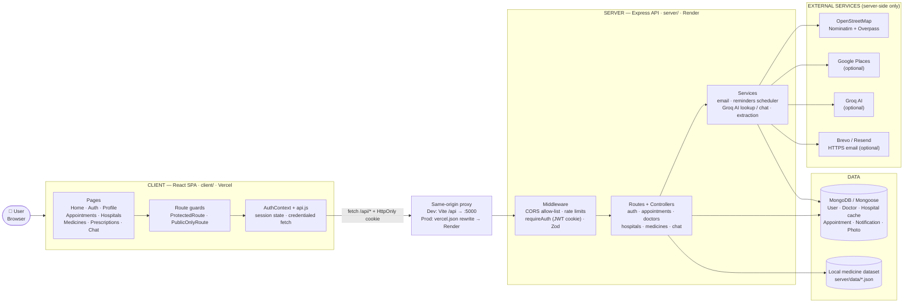
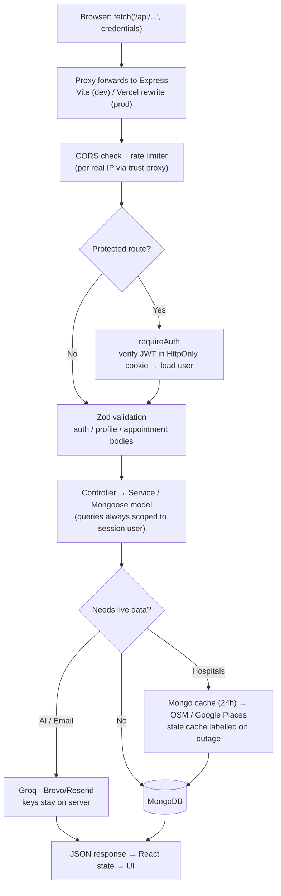
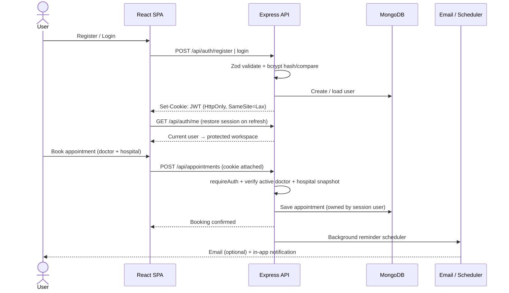

# MediGuide

MediGuide is a full-stack healthcare assistance demo with authenticated patient profiles,
per-user appointments, medicine lookup, map-based hospital search, and educational AI chat.

> **Educational demo only:** MediGuide is not a clinical system and does not provide medical
> advice, diagnosis, or treatment. Use synthetic information only. Never enter real patient
> records, protected health information (PHI), or other sensitive personal information. In an
> emergency, contact local emergency services.

## Tech stack

- **Frontend:** React 19, React Router 7, Vite 7, Tailwind CSS 3
- **Backend:** Node.js, Express 5, MongoDB/Mongoose
- **Authentication:** bcrypt password hashing and JWT sessions in HttpOnly cookies
- **Validation:** Zod on authentication, profile, and appointment request bodies

## Features

- Registration, login, logout, session restoration, and single-use password-reset links
- Public-only auth pages and protected workspace routes
- Persistent, account-specific profile editing with optional profile photos and workspace avatars
- Per-user appointment booking/cancellation with active-provider verification and a validated
  snapshot of the hospital selected from the live directory
- Optional Resend appointment confirmations/reminders and password-reset emails, plus persistent
  in-app reminder/notification APIs
- Synthetic doctor directory with specialty/location filtering
- Live Indian hospital search using OpenStreetMap, 24-hour MongoDB caching, stale-cache fallback,
  and optional Google Places listings/photos
- Medicine browsing by name/composition, A–Z letter, and listed use/category
- Name-matched local medicine images with a generic default illustration
- Prescription image/PDF/text extraction with on-demand Groq details for unmatched medicines
- Existing medicine AI lookup and chat features

## Architecture

MediGuide is a **decoupled SPA + REST API**: the browser only ever calls the relative `/api`
path on its own origin, and a proxy forwards it to the Express API (Vite proxy in development,
Vercel rewrite in production). This keeps the session cookie first-party and avoids CORS
preflight and mixed-content issues.

### 1. System overview



### 2. Request lifecycle (every API call)



### 3. Auth & appointment flow



### Layer guide

| Layer | Location | Responsibility |
| --- | --- | --- |
| Pages & guards | `client/src/pages/`, `components/auth/` | UI routes; block/redirect by session state |
| Client session | `client/src/context/AuthContext.jsx`, `api.js` | Restore user via `/api/auth/me`; all fetches use relative `/api` + credentials |
| Proxy | `client/vite.config.js` (dev), `client/vercel.json` (prod) | Forward `/api/*` to the API so browser stays same-origin |
| Middleware | `server/src/middleware/` | CORS allow-list, rate limiting, `requireAuth`, photo-upload checks |
| Routes → Controllers | `server/src/routes/`, `controllers/` | Map endpoints to handlers (see API table below) |
| Services | `server/src/services/` | Email, reminder scheduler, Groq AI, medicine extraction, password reset |
| Models | `server/src/models/` | Mongoose schemas: `User`, `Doctor`, `Hospital`, `Appointment`, `InAppNotification`, `ProfilePhoto` |

**Dev vs. production:** locally Vite (`:5173`) proxies to Express (`:5000`); in production
Vercel serves the SPA and rewrites `/api/*` to Render. Only the proxy target changes — app code
is identical. See [DEPLOYMENT.md](./DEPLOYMENT.md).

## Getting started

**Prerequisites:** Node.js 18+, MongoDB (local or Atlas).

### 1. Configure

Create `.env` in the **repository root** (the API loads it from there):

```dotenv
MONGODB_URI=mongodb://127.0.0.1:27017/mediguide
JWT_SECRET=replace-with-a-random-secret-at-least-32-characters-long
PORT=5000
CLIENT_ORIGIN=http://localhost:5173
```

```bash
# Generate a JWT secret:
node -e "console.log(require('crypto').randomBytes(48).toString('hex'))"
```

### 2. Run

```bash
# Terminal 1 — API (http://localhost:5000, health: GET /api/health)
cd server && npm ci && npm run dev

# Terminal 2 — Frontend (http://localhost:5173, proxies /api to the API)
cd client && npm ci && npm run dev
```

On startup the API connects to MongoDB and idempotently seeds the synthetic doctors.

### Optional features (add to root `.env` only if needed)

| Feature | Variables | Notes |
| --- | --- | --- |
| AI chat / lookup | `GROQ_API_KEY` | App works without it; AI features are skipped |
| Hospital photos/listings | `GOOGLE_PLACES_API_KEY` | Falls back to free OpenStreetMap search |
| Email (reset + reminders) | `EMAIL_PROVIDER` (`brevo`\|`resend`), `BREVO_API_KEY` or `RESEND_API_KEY`, `MAIL_FROM`, `APP_URL` | Check status at `GET /api/health/email`; full setup in [DEPLOYMENT.md](./DEPLOYMENT.md) |

### Build & test

```bash
cd client && npm run build && npm run preview   # production build
cd server && npm test                            # server tests (no live DB/email needed)
```

## Deployment (Vercel frontend + Render API)

The frontend is deployed to Vercel and the API to Render. The browser never calls Render
directly: it requests `/api/...` on its own origin, and `client/vercel.json` rewrites that path
to the Render service. Same-origin requests mean no CORS preflight, no third-party cookie and no
mixed-content failures.

| Setting | Frontend (Vercel) | API (Render) |
| --- | --- | --- |
| Root directory | `client` | `server` |
| Build command | `npm run build` | `npm ci` |
| Start command | (static) | `npm start` |
| Health check | - | `/api/health` |

Required API environment variables: `NODE_ENV=production`, `MONGODB_URI`, `JWT_SECRET` (32+ chars).
Recommended: `CLIENT_ORIGIN=https://medi-guide-care.vercel.app` and
`APP_URL=https://medi-guide-care.vercel.app`. Leave `VITE_API_URL` unset on Vercel - the
production build uses the relative `/api` base on purpose.

See [DEPLOYMENT.md](./DEPLOYMENT.md) for the full checklist, the request flow diagram and a
troubleshooting table for "Failed to fetch", blank pages and login-not-sticking issues.

## Main routes

| Frontend route | Access | Purpose |
| --- | --- | --- |
| `/` | Public | Landing page |
| `/login`, `/register` | Signed-out only | Account access |
| `/forgot-password`, `/reset-password` | Public | Password recovery |
| `/profile` | Authenticated | Persistent user profile and optional photo |
| `/appointments` | Authenticated | Per-user appointments with hospital selection |
| `/hospitals` | Authenticated | Live map-based hospital directory |
| `/medicines` | Authenticated | Medicine and prescription lookup |
| `/prescriptions` | Authenticated | Prescription workspace placeholder |
| `/chat` | Authenticated | Educational AI assistant |

Appointment booking provides city and specialty dropdowns with plain-language guidance to filter
the synthetic provider directory. Hospital map actions open Google Maps (using the exact Google
Places listing when supplied), while hospital data-source
attribution and the fictional-provider/non-affiliation disclaimers remain visible.

### Authentication and appointment API

| Endpoint | Description |
| --- | --- |
| `POST /api/auth/register` | Create an account and session |
| `POST /api/auth/login` | Sign in |
| `POST /api/auth/forgot-password` | Request a reset email without account enumeration |
| `POST /api/auth/reset-password` | Consume a valid single-use reset token |
| `POST /api/auth/logout` | Clear the session cookie |
| `GET /api/auth/me` | Restore the current user |
| `PATCH /api/auth/profile` | Update allowed profile fields |
| `POST/GET/DELETE /api/auth/profile/photo` | Manage the session user's profile photo |
| `GET /api/appointments` | List only the session user's appointments |
| `POST /api/appointments` | Book with a validated hospital snapshot for the session user |
| `GET /api/appointments/reminders` | List owned reminders and in-app notifications |
| `PATCH /api/appointments/:id/reminders` | Update owned reminder preferences |
| `PATCH /api/appointments/:id/checklist` | Update the owned readiness checklist |
| `PATCH /api/appointments/:id/cancel` | Cancel an owned upcoming appointment |
| `GET /api/hospitals/search` | Search/cache OpenStreetMap or Google hospital listings |
| `GET /api/hospitals/photo` | Proxy an approved Google Places photo reference |
| `GET /api/doctors` | List/filter active synthetic doctors |
| `GET /api/medicines` | Search/filter medicines by `search`, `letter`, and `category` |
| `GET /api/health/email` | Report the active email provider, key presence and parsed sender (no secrets) |

## Project structure

```text
client/src/
├── api.js                       # Credentialed API client
├── context/AuthContext.jsx       # Session and user state
├── components/auth/             # Protected/public-only route guards
├── components/layout/           # Public and authenticated app shells
└── pages/                       # Landing, auth, and workspace pages

server/src/
├── controllers/                 # Auth, appointments, directory, medicines
├── middleware/requireAuth.js     # Verifies cookie session and loads the user
├── models/                      # User, Doctor, Hospital, and Appointment schemas
├── routes/                      # Express API routes
├── services/                    # AI, lookup, and Resend email services
├── utils/session.js              # JWT and secure-cookie helpers
└── validators/                  # Zod request validation
```

## Security

| Area | How it's handled |
| --- | --- |
| Passwords & reset | bcrypt-hashed, never returned by the API; reset tokens are random, hashed at rest, single-use, and expire in 30 min. Login/reset responses never reveal whether an account exists. |
| Sessions | JWT in `HttpOnly`, `SameSite=Lax` cookies (`Secure` in production); prefer the same-origin `/api` proxy over `SameSite=None`. |
| Access control | All profile/appointment reads & writes are scoped to the verified server-side session user. |
| Validation & uploads | Zod-validated request bodies; profile photos ≤ 2 MB, verified by JPG/PNG/WebP file signatures (not browser-declared type). |
| CORS & rate limits | Only allow-listed origins are echoed (never `*` with credentials); auth, reset, and hospital endpoints are rate-limited per real IP (`trust proxy`). |
| Secrets | `JWT_SECRET`, API/email keys stay server-side only and are never exposed to the browser; email content is HTML-escaped. Use a strong secret + HTTPS in production. |

> Educational demo only — not a production healthcare or PHI-storage solution.

## License

See [LICENSE](./LICENSE).
